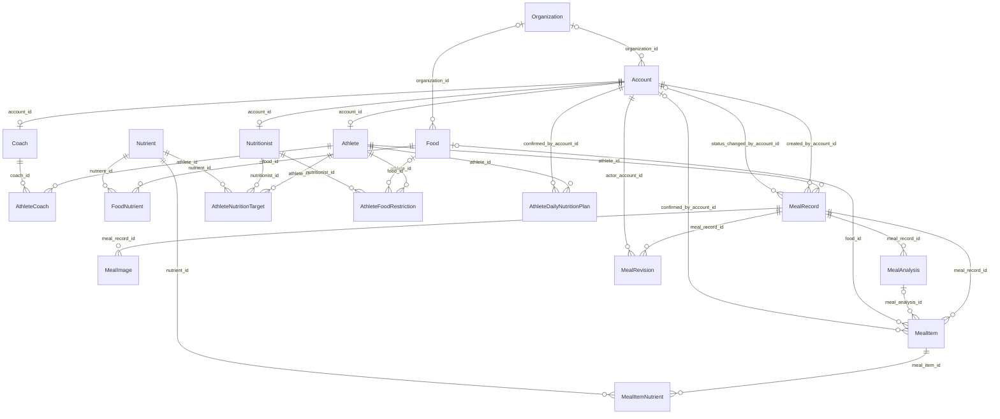

# 完整18表 ERD

完整圖包含Coach與Nutritionist；線條只表示實際FK，角色限制另由SQL驗證。

Account與每個角色profile是1對0..1；每個profile必須有一個Account。

Nutritionist → Account → AthleteDailyNutritionPlan 表示營養師以共用帳號確認。營養師仍直接連AthleteNutritionTarget及AthleteFoodRestriction。
